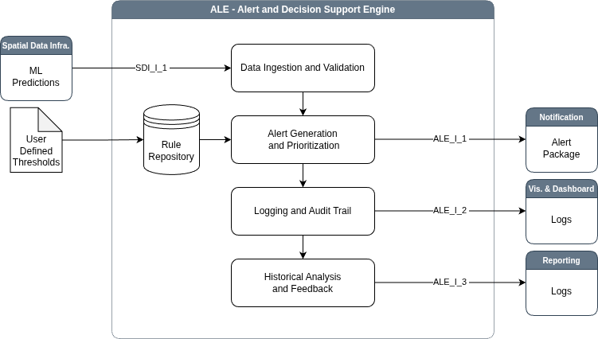

# Alert Decision Support Engine (ALE) Sub-system

The **Alert and Decision Support Engine** continuously processes
information from the SDI sub-system, which provides outputs from
machine learning models such as time series trend analyses,
deformation rates, vegetation and land cover changes, and predictions
of water and soil chemical properties. The ALE evaluates these data to
determine whether conditions at a TSF are normal or indicative of an
anomaly or risk. When a threshold is exceeded or an unusual pattern is
detected, the engine categorizes the severity and sends alerts to the
notification system for dissemination to relevant stakeholders.



## Prototype: `ale_3levels`

ALE turns MAP's forecast residuals into alerts. This prototype runs two engines
on the same input and writes the same output schema, so the two can be compared:

- **A, `fixed_gates`:** fixed thresholds on the 30-day LOS movement (WHITE/GREEN/YELLOW/RED).
- **B, `three_level`:** z-score (L1), CUSUM (L2) and regime-change score (L3). This is
  the three-level prototype moved out of MAP.

Status: **scaffold.** Implemented so far: the contract reader, the engine interface, the
configuration files and `validate`. The engines arrive in later steps (`ALE_PLAN.md` §7).

**Safety:** the engines only emit levels and advisory text. They never execute an
action, call a network service or message another system.

### Layout and boundary

`ale_3levels` reads saved MAP files only. It never imports MAP, and MAP never imports
it; `tests/test_ale_import_boundary.py` enforces this. The root `pytest.ini` puts
`subsystems/ale` on the import path, so it runs without installation;
`pip install -e subsystems/ale` also works.

### Hand-off contract (`ale_3levels/contract.py`)

Input: MAP's forecast-residual table `results/forecasts/<experiment>/residuals.npz`
with its `residuals.json` sidecar (table schema 2.0). There is one row per
(pixel, forecast origin, lead). The reader validates the schema, selects one lead
and returns dense `(time, row, col)` stacks:

| Field | Meaning |
|---|---|
| `observed_mm`, `predicted_mm`, `persistence_mm`, `residual_mm` | cumulative LOS in mm; `residual = observed − predicted` |
| `observed_mm_per_day`, `predicted_mm_per_day`, `residual_mm_per_day` | rate over the forecast interval: `(value − persistence) / Δt` |
| `delta_t_days` | `target_date − last_observation_date` |
| `split` | `train`, `validation`, `calibration`, `monitoring`, `outside` or `no_record` |
| `valid_mask`, `mask` | finite record inside the TSF mask |
| `series_dates`, `observed_series_mm` | observed cumulative LOS on every acquisition (used by engine A) |
| `attrs` | `site_id`, `model_id`, `model_version`, `tsf_version`, units, LOS sign convention, reference date/point, windows, table SHA-256 |

**How `split` is derived.** It combines MAP's temporal `period` with the model's
`sample_role`. Calibration-period rows that were neither trained on nor used for
validation or early stopping are `calibration`.

**Units.** Values are always converted to mm. Synthetic sites are written in
metres while MAP declares mm, so set `input.source_units_override: m` for them.

**Sign convention.** Negative LOS means motion away from the satellite.

**tsf_version.** There is no versioning yet, so `tsf_version` is a provisional
`unversioned-<table hash>`.

### Configuration

- `config/ale.yaml`: engine selection, input, site metadata, spatial aggregation
  (`SpatialCoherenceDetector` parameters).
- `config/fixed_gates.yaml`: engine A gates, boundaries, velocity doubling and advisory text.
- `config/three_level.yaml`: engine B parameters, taken from the prototype.

Changing ALE configuration requires only an ALE re-run.

### Severity mapping (comparison only)

| Severity | A `fixed_gates` | B `three_level` |
|---|---|---|
| 0 | WHITE | NONE |
| 1 | GREEN | L1 |
| 2 | YELLOW | L2 |
| 3 | RED | L3 |
| −1 | NO_DATA | NO_DATA |

### CLI

```bash
python -m ale_3levels validate --input <site>/results/forecasts/slope_trf/residuals.npz
python -m ale_3levels run --engine fixed_gates|three_level|both --input <...> --config config/ale.yaml --out <dir>   # later step
python -m ale_3levels calibrate --engine three_level --input <...> --out <dir>                                  # later step
python -m ale_3levels compare --a <dir_a> --b <dir_b> --out <dir>                                              # later step
```

### Data (kept outside the repository)

Generated data lives in the ALE data directory, by default
`~/ownCloud/Projects/GAIA_TSF/tsf_experiments/ALE-DEV` (override with
`ALE_DATA_DIR`). Nothing generated is committed.

```bash
# Small simulated demo site (about 2.5 MB, ~1 s; no MAP, no site data):
python3 subsystems/ale/scripts/make_demo_data.py --run          # -> ALE-DEV/demo
# Real synthetic site: copy from tsf_experiments + MAP inference (~1.5 min):
subsystems/ale/scripts/prepare_synthetic.sh                       # -> ALE-DEV/synthetic_site
```

### Tests

```bash
python3 -m pytest subsystems/ale/tests
ALE_SYNTHETIC_TABLE=<residuals.npz> ALE_SYNTHETIC_MASK=<tsf_mask.tif> \
  python3 -m pytest subsystems/ale/tests -m slow   # contract vs golden inputs
```

`tests/golden/` holds the prototype's golden outputs (see its README).

### Metric names

Engine B's L3 output is `regime_change_score`: a heuristic score in [0, 1)
(not a probability). The MAP prototype called it `P_regime` (earlier
`regime_risk`); both remain documented aliases (`alerts.json:
metric_aliases`, `outputs.get_metric(arrays, metadata, 'P_regime')`).

### Known limitations

- **Short independent calibration (engine B).** With `calibration.population:
  independent` (B2.2), engine-B baselines use only calibration-period records
  that the model never saw. On the synthetic site (temporal split) that is
  10 acquisitions, mostly from one season (2018-09-17 to 2018-12-10). They
  underestimate the seasonal variability of the L3 regime signal (sigma -36 %
  against the 54-date prototype baseline), so L3 is more sensitive than a
  full-year baseline would make it. The run logs a warning and raises the
  `short_calibration` quality flag when fewer than `calibration.minimum_dates`
  (20) dates are available. Accepted for the prototype (decision 2026-11-25);
  a spatial MAP split or a longer independent calibration period removes it.
- **TSF-level L3 and acceleration baselines** are taken at calibration-split
  dates, but their causal derivative (3 acquisitions) still looks back at up
  to two earlier dates, which may be model-training dates.
