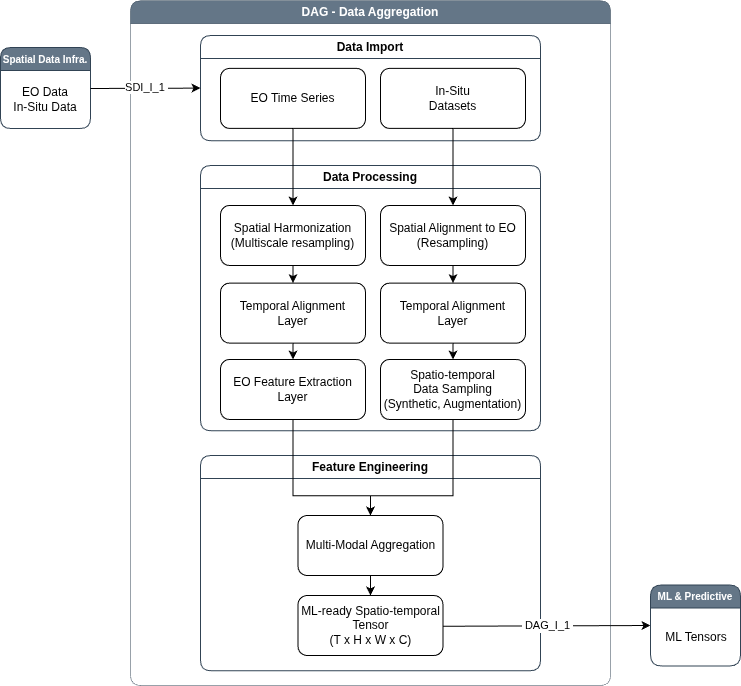

# Data Aggregation (DAG) Sub-system

DAG prepares input data for machine learning. It reads Sentinel-1 LOS
displacement, Sentinel-2 imagery, meteorological data and the DEM from an
experiment directory and writes feature rasters to `<project_dir>/results/`.
Each feature is a GeoTIFF with one band per acquisition date and a
`metadata.json` listing the dates. MAP uses these features to train
forecasting models.



## Configure

Edit `subsystems/dag/config.yaml`:

- `project_dir`: the experiment directory, which contains `inputs/` and `static/`.
- `slope_stability.inputs.los.filename_pattern`: the LOS file names, for
  example `los_*.tif` or `tsf_los_*.tif` for synthetic scenarios.
- `slope_stability.static`: the TSF mask and an optional stable reference
  mask, both in `static/`.
- `slope_stability.results.temporal_features.current`: set
  `enabled: true, features: [cumulative_los]` so that DAG writes the MAP
  target `cumulative_los_current`.
- `amd.feature_engineering`: the two Sentinel-2 bands and the method
  (`ratio` or `difference`).

Normalization, missing-value filling and outlier handling are under
`preprocessing`. All three are disabled by default.

## Run

Every pipeline uses the same command:

```bash
python3 subsystems/dag/run_pipeline.py --pipeline <name> --config subsystems/dag/config.yaml
```

Slope stability (InSAR):

```bash
python3 subsystems/dag/run_pipeline.py --pipeline slope_eda               --config subsystems/dag/config.yaml
python3 subsystems/dag/run_pipeline.py --pipeline slope_features          --config subsystems/dag/config.yaml
python3 subsystems/dag/run_pipeline.py --pipeline slope_temporal_features --config subsystems/dag/config.yaml   # features for MAP
```

AMD (Sentinel-2), run in this order:

```bash
python3 subsystems/dag/run_pipeline.py --pipeline amd_index             --config subsystems/dag/config.yaml
python3 subsystems/dag/run_pipeline.py --pipeline amd_eda               --config subsystems/dag/config.yaml
python3 subsystems/dag/run_pipeline.py --pipeline amd_features          --config subsystems/dag/config.yaml   # target for MAP
python3 subsystems/dag/run_pipeline.py --pipeline amd_temporal_features --config subsystems/dag/config.yaml   # features for MAP
python3 subsystems/dag/run_pipeline.py --pipeline amd_meteo_features    --config subsystems/dag/config.yaml
```

Contextual features:

```bash
python3 subsystems/dag/run_pipeline.py --pipeline meteo_features       --config subsystems/dag/config.yaml
python3 subsystems/dag/run_pipeline.py --pipeline topographic_features --config subsystems/dag/config.yaml
```

## Test

```bash
PYTHONPATH=. pytest subsystems/dag/tests
```
