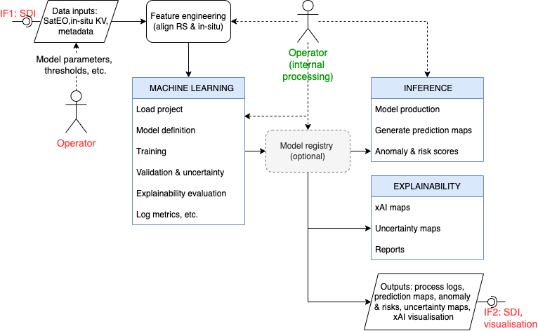

# Machine Learning Predictive Analytics (MAP) Sub-system

Trend detection, anomaly analysis, and dynamic risk scoring.

The **Machine Learning Predictive Analytics** sub-system functions as
the core intelligence engine of the GAIA-TSF architecture, responsible
for transforming historical and current monitoring data into
actionable predictive insights (trend, anomaly, and risk scoring). The
sub-system is designed to execute comprehensive modeling workflows
that include data ingestion, feature engineering, model training,
inference, and output results upload.



### Multi-Variable Time Series Monitoring Framework
This subsystem implements a modular machine learning framework for monitoring geophysical processes from time series data. It is designed to support multiple variables (e.g., slope stability, AMD) and multiple model types (e.g., LSTM, Random Forest, XGBoost) within a unified, reproducible pipeline.

### Key Features
* **Plugin Architecture**
  Variables, feature engineering pipelines, and models are implemented as independent plugins. This enables flexible combinations without modifying core code.

* **Multi-Variable Support**
  * **Slope Stability** (InSAR displacement time series)
    * Models: LSTM, Random Forest
    * Features: engineered temporal features

  * **AMD** (planned Sentinel-2 indicator time series)
    * Registered models: constant, Gradient Boosting Regressor, Random Forest
    * [Input data contract](AMD_INPUTS.md): shared raster format, masks, dates,
      causal predictors, and remaining implementation decisions
    * Sentinel-2 feature generation and AMD preprocessing remain pending

* **Unified Pipelines**
`
  * `learning_pipeline`: training and experiment registration
  * `inference_pipeline`: prediction, residual computation, and persisted
    hand-off products
  * `monitoring_pipeline`: anomaly detection, spatial coherence, GIS products,
    dashboard, and optional causal animation

* **Physics-Informed Monitoring Layer**
  Predictions are transformed into risk signals using methods such as:

  * CUSUM (persistent acceleration detection)
  * Bayesian online change point detection
  * Regime classification (acceleration, deceleration, oscillation)


### Architecture Overview

```
plugins/
  variables/     # variable-specific logic (slope, AMD)
  features/      # feature engineering pipelines
  models/        # ML models (LSTM, RF, XGB)

core/
  interfaces.py  # common abstractions
  registry.py    # plugin registration

pipelines/
  learning_pipeline.py
  inference_pipeline.py
  monitoring_pipeline.py

dataset/         # data loading and windowing
monitoring/      # change detection and risk analysis
registry/        # experiment tracking
utils/           # shared utilities
```


### Usage 

```yaml
variable: slope
model: rf

look_back: 9
horizon: 1
```

```bash
python3 subsystems/map/run_learning.py  \
  --config subsystems/map/config.yaml

python3 subsystems/map/run_inference.py   \
  --config subsystems/map/config.yaml

# Re-run thresholds, spatial coherence, dashboard, and optional animation
# without recalculating model predictions.
python3 subsystems/map/run_monitoring.py  \
  --config subsystems/map/config.yaml
```

Inference writes its internal, versioned monitoring hand-off to
`results/inference/monitoring_input.npz`. Monitoring consumes this artifact
and writes operational results below `results/anomalies/` and
`results/monitoring/`. Set `monitoring.run_after_inference: true` for a
single-command batch run; it is `false` by default. Set
`monitoring.animation.enabled: true` to produce the animation and its CSV
from the persisted inference stacks during the monitoring stage.


### Test

```bash 
TODO: 
```

### Spatial calibration support

Sites that lack a deformation-free historical period can calibrate the normal
behaviour model on a surveyed stable area while retaining the full TSF for
inference and monitoring:

```yaml
datasets:
  slope_dataset:
    mask_file: tsf_mask.tif
    stable_file: tsf_stable.tif
    calibration_spatial_selection:
      method: configured_mask
```

Supported methods are:

- `temporal_std`: backward-compatible automatic selection below
  `baseline_model.stable_pixel_std_threshold` across the TSF mask.
- `configured_mask`: use the configured stable-mask population directly; the
  temporal standard-deviation threshold is not applied. Dataset construction
  still removes samples whose required features or target are missing.
- `configured_mask_and_temporal_std`: apply the temporal threshold inside the
  configured stable mask.

`calibration_spatial_selection.mask_file` may override `stable_file`. The mask
must be binary, nonempty, and share the feature grid. Stable pixels may lie
outside `mask_file`, including an entirely separate reference area within the
LOS image. Training requires finite target and feature values at those pixels.
For external stable pixels, DAG temporal features must be regenerated with
`slope_stability.static.stable_reference.file` set to the same mask filename
(default `tsf_stable.tif`). Temporal feature generation retains the union of
TSF and stable pixels; older TSF-only rasters contain no usable external samples.
Any other required feature rasters must also cover the stable area.
Only learning uses the stable area. Inference, residual maps,
and monitoring continue over `mask_file`. The experiment metadata records the
method, mask path, configured and selected pixel counts, and threshold.
Temporal stability selection, when enabled, is calculated only from the
configured calibration dates within the selected calibration area.

Spatial selection does not replace temporal windows. Learning uses the Cartesian
intersection of the selected calibration pixels and calibration dates. The
calibration `start_date` is inclusive and `end_date` is exclusive. Monitoring
uses the full TSF mask and its configured window, with both dates inclusive:

```yaml
temporal_windows:
  calibration:
    start_date: '2015-04-30'  # included
    end_date: '2017-01-01'    # excluded; may be monitoring start
  monitoring:
    start_date: '2017-01-01'  # included
    end_date: '2018-02-20'    # included
```

Calibration and monitoring windows are independent and may overlap, including
covering the same full period. To learn normal behaviour from `tsf_stable.tif`
over all dates and monitor `mask_file` from the beginning, use:

```yaml
calibration_spatial_selection:
  method: configured_mask
split:
  method: spatial
  train_ratio: 0.5
  validation_ratio: 0.25
  test_ratio: 0.25
temporal_windows:
  calibration:
    full_period: true
  monitoring:
    full_period: true
```

`full_period: true` includes the first and last available acquisition and takes
precedence over explicit date bounds. Spatial splitting retains the full time
axis in each split while holding out stable pixels for validation and testing.
LSTM predictions begin once the required feature lags and sequence history are
available; physical observations can be displayed from the first acquisition.
This full-period fit supports retrospective monitoring: early predictions use a
model trained with later stable-area observations. Monitoring statistics also
use their configured calibration period to establish their reference levels.

Only real acquisition dates within these calendar bounds are selected; dates in
the YAML do not need to match an acquisition exactly. The split method controls
what model generalization is validated:

```yaml
split:
  method: temporal  # or spatial
  random_seed: 42   # used by spatial splitting
  train_ratio: 0.5
  validation_ratio: 0.25
  test_ratio: 0.25
```

`temporal` creates chronological subdivisions of the calibration window and
tests generalization to later acquisitions. `spatial` randomly assigns complete
pixel histories to mutually exclusive subsets, so validation and test cover the
whole calibration period while measuring generalization to unseen locations.
The experiment seed is used when `random_seed` is omitted. The monitoring
window never contributes samples to model fitting.
