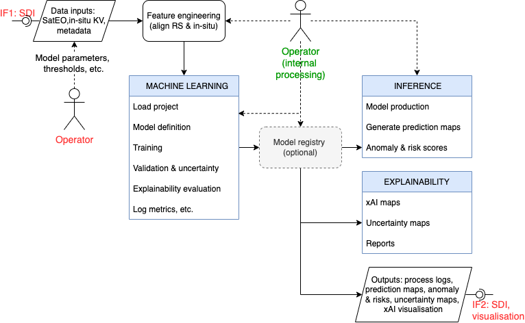

# Machine Learning Predictive Analytics (MAP) Sub-system

MAP forecasts the target variable of each key variable (KV) from DAG
features:

- **Slope stability (InSAR):** cumulative LOS displacement in mm.
- **AMD (Sentinel-2):** the AMD index.

MAP trains a model on normal reference data, forecasts the next 1, 3 or 5
acquisitions, and compares the forecasts with new observations. The
differences (residuals) go to ALE, which detects anomalies and raises alerts.
MAP itself does not raise alerts.

Three models are available:

- `constant`: repeats the last observed value (baseline).
- `trf`: Random Forest.
- `lstm`: recurrent neural network.



## Before you start

Run DAG first. MAP reads the DAG features from `<experiment_dir>/results/`.

## Configure

Edit `subsystems/map/config.yaml`:

- `dataset` and `model`: what to run. The command line can override both.
- `forecast.horizon`: how many acquisitions ahead to forecast (1, 3 or 5).
- `datasets.<name>`:
  - `experiment_dir`: the experiment directory.
  - `mask_file`: the monitored area, in `static/`.
  - `target_feature`: the DAG stack to forecast.
  - `features`: the DAG stacks used as predictors.
  - `calibration_spatial_selection`: the area used for training.
  - `split`: how the reference data is divided into training, validation and
    test sets.
  - `temporal_windows`: the calibration (normal) period and the monitoring
    period.
- `plotting.enabled`: set to `true` to write diagnostic plots.

## Run

```bash
# 1. Train and validate
python3 subsystems/map/run_learning.py  --config subsystems/map/config.yaml --dataset slope_dataset --model trf

# 2. Forecast and compare with observations
python3 subsystems/map/run_inference.py --config subsystems/map/config.yaml --dataset slope_dataset --model trf
```

For AMD, use `--dataset amd_dataset`. For another model, use
`--model constant` or `--model lstm`.

Optional: tune TRF or LSTM settings before forecasting. This replaces step 1:

```bash
python3 subsystems/map/run_tuning.py --config subsystems/map/config.yaml --dataset slope_dataset --model trf
```

Tuning tries the settings listed under `tuning.search` and scores each one on
several chronological folds of the normal data. The test split is excluded.
The setting with the lowest error is then used to retrain the model.

The results go to `results/tuning/<kv>_<model>/`. To keep the tuned settings
for later runs, copy `tuned_config.yaml` into `config.yaml`. Use
`--no-retrain` to search without retraining.

Compare models on the same observations:

```bash
python3 subsystems/map/run_compare.py \
    trf=<experiment_dir>/results/forecasts/slope_trf/residuals.npz \
    lstm=<experiment_dir>/results/forecasts/slope_lstm/residuals.npz
```

## Results

- `results/models/<kv>_<model>/`: the trained model, `experiment.json`, and
  `validation_metrics.csv` (errors per lead time, compared with the
  `constant` baseline).
- `results/forecasts/<kv>_<model>/`: `forecasts.npz`, `residuals.npz` (for
  ALE), and `forecast_errors.csv`. Each `.npz` file has a `.json`
  description.

## Test

```bash
python3 -m pytest subsystems/map/tests
```
