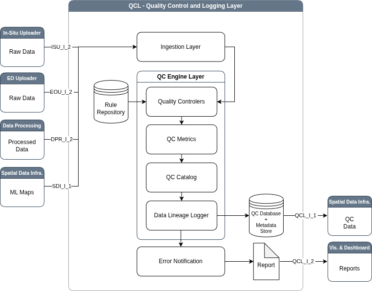

# Quality Control and Logging Layer (QCL) Sub-system

The **Quality Control Layer** serves as the critical validation gatekeeper
within the GAIA-TSF monitoring architecture, situated between the
ingestion/ETL processes and the Spatial Data Infrastructure (SDI)
storage. Its primary function is to enforce established quality
standards across all incoming data streams, ensuring that only
reliable and traceable data supports the downstream analytics and
decision-making modules. This layer automates the verification of data
integrity through specific checks—such as validating physical ranges
for pH levels in water quality data or assessing cloud cover
percentages in satellite imagery—and logs the lineage of every dataset
to maintain a complete audit trail. By combining automated metric
calculation with mechanisms for manual review and error alerting, the
system guarantees high-fidelity inputs for predictive modeling and
risk assessment.

Its job is to validate all data (In-Situ and Earth Observation) before
it is saved or analyzed. It ensures the system only uses high-quality,
realistic data.



## Key Features
* **Automated QC**: Runs real-time checks using the `qc_layer.check()` method.
* **Status Tagging**: Automatically marks datasets as `Pass`, `Warn`, or `Fail`.
* **Data Lineage**: Keeps a permanent record of all checks for safety audits.
* **Smart Metadata Validation**: Checks for missing fields in EO data and triggers warnings.

## Folder Structure
* `__init__.py`: Provides the **`QCLayer`** alias for easy importing.
* `layer.py`: Contains the **`QualityControlLoggingLayer`** class and core logic.
* `README.md`: This documentation file.

## Interfaces
* **Input**: Intercepts DataFrames from `ISU` (In-Situ) and `EOU` (Earth Observation).
* **Output**: Sends verified data to the SDI and alerts to the Notification system.

## Usage

This example shows the standard way to use the QCL, matching the logic in our unit tests.

```python
import pandas as pd
# 1. Import the QCLayer alias
from subsystem.qcl import QCLayer 

# 2. Initialize the component as 'qc_layer'
qc_layer = QCLayer()

# 3. Create sample In-Situ data (pH values)
# In our tests, pH > 14 will trigger a failure.
df = pd.DataFrame(
    {'ph': [7.2, 15.5, 8.1]}, 
    index=[101, 102, 103]
)

# 4. Perform the check
# Usage follows the qc_layer.check() pattern
result = qc_layer.check(
    data_type='in_situ',
    data=df,
    metadata={'sensor': 'piezometer'},
    dataset_id='TEST_BATCH_001'
)

# 5. Handle the result
if result['final_status'] == 'Fail':
    print(f"Data Rejected! Errors: {result['errors']}")
    # Expected: "pH values out of 0-14..."
```

### Define logging tasks

A *task* groups related log records under a common `task_id`. Task start
and end are defined by the user, either by a context manager (recommended)
or by explicit `task_started()`, `task_finished()` and `task_failed()` calls.

Context manager logs `TASK_STARTED` on enter, `TASK_FINISHED` on exit and
`TASK_FAILED` when an exception is raised (the exception is re-raised). There
is no need to catch errors in order to mark the task as failed, raising
`GaiaError` (or any other exception) inside the block triggers `task_failed`
automatically.

The task ID is yielded by the context manager:

```python
import pandas as pd
from subsystems.qcl import QCLayer

qc_layer = QCLayer()
df = pd.DataFrame({'ph': [7.2, 6.8, 8.1]}, index=[101, 102, 103])

with qc_layer.logger.task(qc_layer) as task_id:
    qc_layer.logger.info(f'Checking batch (task_id={task_id})')
    result = qc_layer.check('in_situ', df, {}, 'TEST_BATCH_001')

# task_id is still available after the block, e.g. to query its log records
print(f'QC finished with {result["final_status"]}, see logs of task {task_id}')
```

The ID of the active task can also be read from the logger context. This is
useful deeper in the code, where the context manager variable is not
available. It is `None` when no task is active:

```python
task_id = self.logger.extra.get('task_id')
```

Notes:

* Log records emitted between task start and end carry the `task_id`,
  records after the task is finished/failed carry no `task_id`.
* Each task is stored in the `task` table (name, start and end time, status
  `TASK_STARTED`, `TASK_FINISHED` or `TASK_FAILED`). Task IDs are generated
  by DB (unique across processes), log records refer to the task by
  `log.task_id`. Subsystem, site/project and pid of the task are available
  in its `TASK_STARTED` log record. When DB logging is not configured, a
  process-local counter is used instead.
* Only one active task per logger is supported, nested (or overlapping)
  tasks are not. When a new task is started before the previous one is
  finished, the new task ID replaces the previous one. `TASK_STARTED`,
  `TASK_FINISHED` and `TASK_FAILED` records are still logged with correct
  task IDs, but records of the outer task logged after the inner task is
  finished carry no `task_id`.
* Task ID is kept per logger instance (each subsystem object derived from
  `GaiaBase` has its own logger). Start the task by the logger of the object
  which does the work (e.g. `pipeline.logger.task(pipeline)`), otherwise its
  records will not carry the `task_id`.

### Access logs

Go to `docker` directory and run:

```sh
docker compose exec postgis psql logging -U postgres -c 'select lo.id,s.description subsystem,timestamp,lv.name,message,project_name,pid,task_id from log lo join log_level lv on level_id=lv.id join subsystem s on subsystem_id=s.id order by lo.id desc limit 1'
```

Example above retrieves the most recent log entry from the database.

To list the most recent tasks including status and duration:

```sh
docker compose exec postgis psql logging -U postgres -c 'select t.id,t.name,l.subsystem_id,l.project_name,lv.name status,t.started,t.finished-t.started duration from task t join log l on l.task_id=t.id and l.level_id=101 join log_level lv on t.status_id=lv.id order by t.id desc limit 10'
```

To retrieve all log entries of a given task (e.g. `task_id=2`):

```sh
docker compose exec postgis psql logging -U postgres -c 'select lo.id,timestamp,lv.name,message from log lo join log_level lv on level_id=lv.id where task_id=2 order by lo.id'
```
